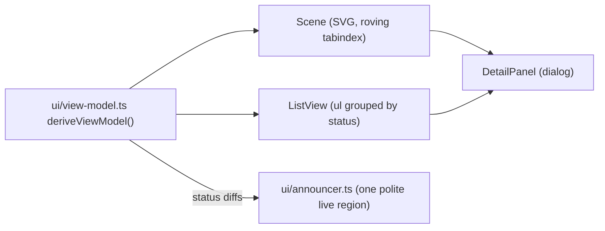

# Design: accessible-list-view

## Overview

One derived list, two renderings. `ui/ListView.tsx` and `scene/Scene.tsx` both take the output of `deriveViewModel(items, now, userZone)`, so the two views cannot disagree. Keyboard logic lives in small pure helpers so it can be unit-tested.

## Architecture



## Data model

```ts
interface ViewEntry {
  id: string;
  title: string;
  status: Status;
  statusText: string;           // 'due soon', 'active', 'ghost (inactive 9 days)', ...
  dueText: string;              // in user zone
  sourceDueText?: string;       // when zone differs
  epitaph?: string;
  demo: boolean;
  actions: Array<'submit' | 'revive' | 'bury' | 'edit' | 'epitaph'>;
  accessibleName: string;       // R3.1
}
interface ViewModel { entries: ViewEntry[]; groups: Array<{ status: Status; heading: string; ids: string[] }>; }
```

## Interfaces

```ts
export function deriveViewModel(items: Item[], now: EpochMs, userZone: string, locale: string): ViewModel;
export function allowedActions(status: Status): ViewEntry['actions'];
export function nextFocusIndex(current: number, key: string, count: number): number; // Left, Right, Home, End
export function diffStatuses(prev: Map<string, Status>, next: Map<string, Status>): Array<{ id: string; from: Status; to: Status }>;
export function createAnnouncer(el: HTMLElement): { announce(text: string): void };
```

Dialog: native `<dialog>` with `showModal()` for focus containment (confirm current browser support and focus behaviour on MDN before use), with a fallback focus trap if `showModal` is missing. The opener element is stored and refocused on close (R2.4).

## Error handling

- If an item fails to format (bad zone in stored data), its entry shows "time unavailable" and a repair action instead of crashing the list.
- The announcer de-duplicates identical messages within 1 s.

## Testing strategy

- Unit: `deriveViewModel` (one entry per item, grouping order, Demo label, source zone text), `allowedActions`, `nextFocusIndex`, `diffStatuses`.
- happy-dom: skip link moves focus; Escape returns focus to opener; live region text after a status change.
- Playwright + axe: keyboard-only walkthrough of both views, zero axe violations in each, focus ring visible (screenshot).
- Parity test: for random item lists (fast-check), the set of ids in the scene equals the set in the list view (R1.1).
