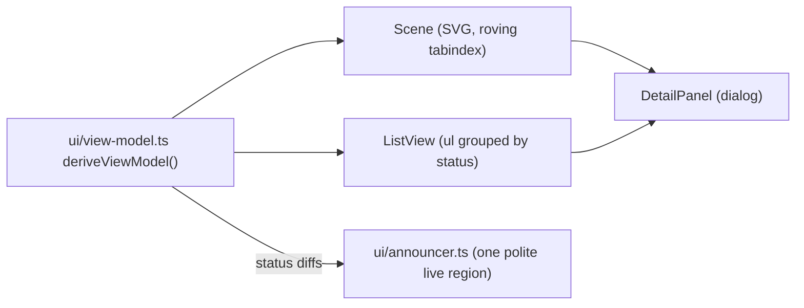

# Design: accessible-list-view

## Overview

One derived list, two renderings. `ui/ListView.tsx` and `scene/Scene.tsx` both take the output of `deriveViewModel(items, now, userZone)`, so the two views cannot disagree. Keyboard logic lives in small pure helpers so it can be unit-tested.

## Architecture



## Data model

```ts
interface ViewEntry {
  id: string;
  title: string;
  status: Status;
  statusText: string;           // 'due soon', 'active', 'ghost (inactive 9 days)', ...
  dueText: string;              // in user zone
  sourceDueText?: string;       // when zone differs
  epitaph?: string;
  demo: boolean;
  relativeText: string;         // coarse '2 days left', changes at most hourly, not in the accessible name (R3.3)
  dateOnly: boolean;
  actions: Array<'submit' | 'revive' | 'bury' | 'edit' | 'epitaph'>;
  accessibleName: string;       // R3.1, plus ', Demo' for demo data
}
interface ViewModel { entries: ViewEntry[]; groups: Array<{ status: Status; heading: string; ids: string[] }>; }
```

## Interfaces

```ts
export function deriveViewModel(items: Item[], now: EpochMs, userZone: string, locale: string): ViewModel;
export function allowedActions(status: Status): ViewEntry['actions'];
export function nextFocusIndex(current: number, key: string, count: number): number; // Left/Right (Up/Down too), Home, End
export function diffStatuses(prev: Map<string, Status>, next: Map<string, Status>): Array<{ id: string; from: Status; to: Status }>;
export function createAnnouncer(el: HTMLElement, clock?: () => number): { announce(text: string): void };
```

Dialog (`ui/Modal.tsx`): native `<dialog>` with `showModal()`, which per MDN makes the rest of the page inert and moves focus to the first focusable element; a small Tab trap is the fallback when `showModal` is missing. Escape (keydown and the `cancel` event) closes it. App stores the opener and refocuses it on close; if the opener left the DOM (the entry moved group or was deleted) it focuses the same item's scene element or Details button, then the list heading (R2.4).

Scene items are SVG `<g role="button">` elements. The roving tabindex is written as the lowercase `tabindex` attribute: Preact sets SVG attributes verbatim, and a camelCase `tabIndex` attribute on an SVG element is not recognised by browsers (found by `Scene.test.tsx`).

View toggle (R1.6): "Scene and list" shows the scene with the full list below it, "List only" hides the scene. The list is always rendered, so the skip link always has a target.

## Error handling

- If an item fails to format (bad zone in stored data), its entry shows "time unavailable" and a repair action instead of crashing the list.
- The announcer de-duplicates identical messages within 1 s.

## Testing strategy

- Unit: `deriveViewModel` (one entry per item, grouping order, Demo label, source zone text), `allowedActions`, `nextFocusIndex`, `diffStatuses`.
- happy-dom: skip link moves focus; Escape returns focus to opener; live region text after a status change.
- Playwright + axe: keyboard-only walkthrough of both views, zero axe violations in each, focus ring visible (screenshot).
- Parity test: for random item lists (fast-check), the set of ids in the scene equals the set in the list view (R1.1).
