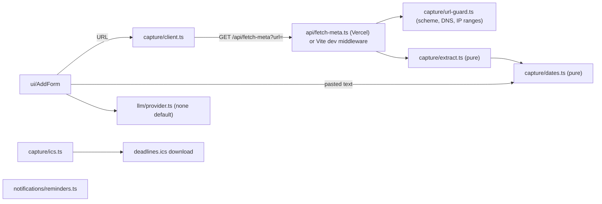

# Design: capture-and-export

## Overview

The browser cannot read arbitrary pages because of CORS, so page fetching happens in one small server function. Extraction itself is a pure module shared by the function, the dev proxy and the "paste page text" path.

## Architecture



## Interfaces

```ts
// capture/url-guard.ts
export function checkUrlSyntax(raw: string): { ok: true; url: URL } | { ok: false; reason: 'scheme' | 'invalid' | 'credentials' };
export function isPublicAddress(ip: string): boolean; // rejects 10/8, 172.16/12, 192.168/16, 127/8, 169.254/16, 100.64/10, 0/8, ::1, fc00::/7, fe80::/10, IPv4-mapped forms

// capture/extract.ts
export interface Extracted { title?: string; startDate?: string; endDate?: string; zoneHint?: string; source: string }
export function extractMeta(html: string, sourceUrl: string): Extracted; // <title>, og:title, JSON-LD Event startDate/endDate

// capture/dates.ts
export function findDateCandidates(text: string, referenceZone: string): Array<{ text: string; date: string; time?: string; zone?: string }>;

// capture/ics.ts
export function toIcs(items: Item[], now: EpochMs): string;
export function parseIcs(text: string): Array<Pick<Item, 'id' | 'title' | 'dueAt' | 'zone' | 'dateOnly'>>;

// llm/provider.ts
export interface LlmProvider {
  id: 'none' | 'gemini' | 'groq' | 'ollama';
  extractDeadline(text: string): Promise<{ title?: string; date?: string; time?: string; zone?: string } | null>;
  phrasePlan(answers: SeanceAnswers, draft: PlanDraft): Promise<string | null>;
}
```

### Server function (`api/fetch-meta.ts`)

- Vercel Node function. Exact handler signature, runtime config, `maxDuration` and free-tier limits must be confirmed in Vercel's official docs before writing it.
- Steps: `checkUrlSyntax`, DNS lookup with `node:dns/promises` `lookup(host, { all: true })`, reject if any address fails `isPublicAddress`, fetch with `redirect: 'manual'` and repeat the checks for each `Location` (max 3), `AbortSignal.timeout(5000)`, stream the body and stop at 1 MB, then `extractMeta`. Response is JSON `Extracted` or `{ error }`, with `Cache-Control: no-store`.
- Known limitation, documented: DNS rebinding between the check and the connect is not fully prevented without a custom connect hook; the 5 s, 1 MB and fields-only limits bound the impact.
- Local dev: a Vite plugin with `configureServer` registers the same handler at `/api/fetch-meta` (hook point already in `vite.config.ts`).

### `.ics`

- `DTSTART;TZID=<zone>:<local>` for timed items, `DTSTART;VALUE=DATE:<date>` plus `X-DG-DATE-ONLY:TRUE` for date-only items. `VTIMEZONE` blocks are omitted; this is a known interoperability limit for some clients and is noted in README. Property P6 checks round trip with the app's own parser; a manual check imports the file into one real calendar app.
- UID is `<item.id>@deadline-graveyard`.

### Notifications

- `Notification.requestPermission()` only from the reminders toggle click. A registered service worker shows notifications with `registration.showNotification`. Scheduling uses a timer while the page is open; there is no push server, which the UI states.

### LLM providers

- `none` is the default and is fully rule-based.
- `gemini`, `groq`, `ollama` call their documented REST endpoints from the browser with the user's key (or local Ollama URL). Endpoints, request bodies, CORS support from browsers and free-tier limits must each be confirmed in the provider's official docs before implementation. If a provider does not allow browser calls, it is dropped and the decision is recorded here.
- Outputs are validated (date parses, zone valid) before being offered as suggestions.

## Error handling

All failures become typed results shown inline next to the form: `invalid-url`, `blocked-address`, `timeout`, `too-large`, `no-date-found`, `network`. Manual entry stays available in every state.

## Testing strategy

- Unit: `checkUrlSyntax`, `isPublicAddress` (table of addresses), `extractMeta` against hand-written HTML fixtures, `findDateCandidates`, `toIcs` escaping and folding, `parseIcs`.
- Property: P6 `.ics` round trip; `isPublicAddress` never accepts any generated address from the private ranges.
- Function test: the handler with a mocked `fetch` and mocked `lookup` (private IP rejected, redirect to private IP rejected, size cap, timeout).
- E2E: manual entry path works with the network blocked.
