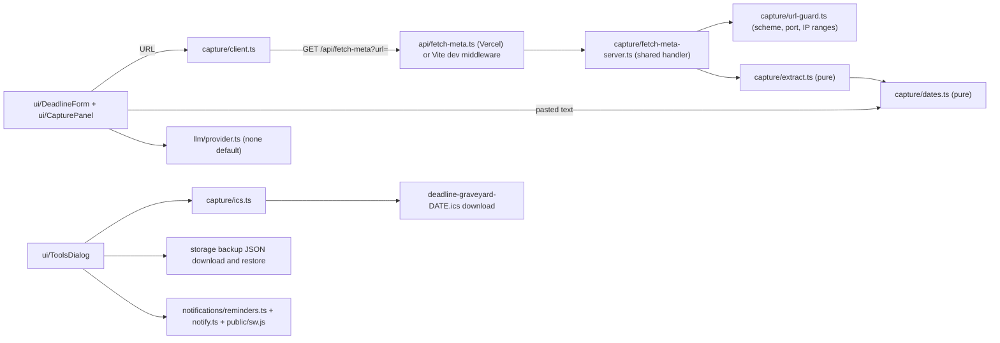

# Design: capture-and-export

## Overview

The browser cannot read arbitrary pages because of CORS, so page fetching happens in one small server function. Extraction itself is a pure module shared by the function, the dev proxy and the "paste page text" path.

## Architecture



## Interfaces

```ts
// capture/url-guard.ts
export function checkUrlSyntax(raw: string): { ok: true; url: URL } | { ok: false; reason: 'scheme' | 'invalid' | 'credentials' | 'port' };
export function isPublicAddress(ip: string): boolean; // only global unicast; rejects 0/8, 10/8, 100.64/10, 127/8, 169.254/16, 172.16/12, 192.0.0/24, 192.0.2/24, 192.88.99/24, 192.168/16, 198.18/15, 198.51.100/24, 203.0.113/24, 224/4, 240/4, ::, ::1, fc00::/7, fe80::/10, multicast, documentation ranges, and IPv4-mapped, NAT64 and 6to4 forms of blocked IPv4

// capture/extract.ts
export interface Extracted { title?: string; startDate?: string; endDate?: string; zoneHint?: string; dateSource?: 'json-ld' | 'meta' | 'time-element'; source: string }
export function extractMeta(html: string, sourceUrl: string): Extracted; // og:title, <title>, JSON-LD Event (incl. @graph, subtypes), event meta tags, <time datetime>

// capture/dates.ts
export interface DateCandidate { text: string; date: string; time?: string; zone: string; zoneAssumed: boolean }
export function parseIsoLike(value: string, referenceZone: string): DateCandidate | null;
export function findDateCandidates(text: string, referenceZone: string, limit?: number): DateCandidate[];

// capture/fetch-meta-server.ts (Node only)
export function fetchMeta(rawUrl: string, deps: FetchDeps): Promise<{ ok: true; value: Extracted } | { ok: false; error: FetchMetaError }>;
export function handleFetchMeta(request: Request, deps?: FetchDeps): Promise<Response>; // never throws

// capture/ics.ts
export function toIcs(items: Item[], now: EpochMs): string;
export function parseIcs(text: string): Array<{ id: string; title: string; dueAt: EpochMs; zone: string; dateOnly: boolean; demo: boolean }>;

// llm/provider.ts
export interface LlmProvider {
  id: 'none' | 'gemini' | 'groq' | 'ollama';
  extractDeadline(text: string): Promise<{ title?: string; date?: string; time?: string; zone?: string } | null>;
  phrasePlan(prompt: { answers: string[]; planLines: string[] }): Promise<string | null>; // used by the seance spec
}
```

`phrasePlan` takes plain answer and plan lines instead of the seance types so the adapter does not import from `src/seance/`, which does not exist yet.

### Server function (`api/fetch-meta.ts`)

- Vercel Node.js runtime function using the Web standard `fetch` export (`export default { fetch(request) }`), as in the Node.js runtime docs. Vercel creates one function per supported file in the root `api/` directory, so no `vercel.json` is needed. On the Hobby plan the default and maximum duration is 300 s, memory is 2 GB and the request or response body limit is 4.5 MB; this function's own 5 s budget and small JSON reply stay well inside them.
- `api/fetch-meta.ts` only re-exports `handleFetchMeta` from `src/capture/fetch-meta-server.ts`, and the Vite dev middleware calls the same function, so local dev and the hosted app run the same code.
- Steps for the first URL and every redirect hop: `checkUrlSyntax` (http or https, ports '', 80, 443, 8080, 8443 only, no credentials), DNS with `node:dns/promises` `lookup(host, { all: true, verbatim: true })`, refuse if **any** address fails `isPublicAddress`, then one GET with `node:http` / `node:https` and a custom `lookup` that only returns the addresses already checked. One `AbortSignal.timeout(5000)` covers the whole chain, at most 3 redirects, `text/html` or `application/xhtml+xml` only, and at most 1 MB of body is read. The reply is JSON `Extracted` or `{ error }` with `Cache-Control: no-store`.
- Change from the first draft: the request uses `node:http` instead of global `fetch`, because `fetch` has no option to pin the connection to checked addresses without adding a dependency (an undici dispatcher). Pinning the lookup closes the DNS rebinding gap that the first draft listed as a known limitation.
- Change from the first draft: a body over 1 MB is cut at 1 MB, not refused, because the title and JSON-LD are in `<head>`. The `too-large` error was therefore dropped.
- Local dev: a Vite plugin with `configureServer` (`apply: 'serve'`) mounts the handler at `/api/fetch-meta`. `vite preview` has no API, so the client reports `unavailable` there and the paste and manual paths take over.

#### TypeScript import extensions on Vercel

`src/` imports use `.ts` extensions (`allowImportingTsExtensions`). Vercel compiles each function file with the project's `tsconfig.json` and keeps import specifiers as written, so `tsconfig.json` also sets `rewriteRelativeImportExtensions: true` (TypeScript rewrites `./x.ts` to `./x.js` on emit) and `rootDir: "."`. Checked on 16 Nov 2026 without logging in or deploying:

1. Copy the repo to a temp folder (with `node_modules`, without `.git` and `dist`).
2. Write `.vercel/project.json` with placeholder ids and `"settings": { "framework": "vite", "buildCommand": "npm run build", "outputDirectory": "dist", "installCommand": "true", "nodeVersion": "22.x" }`.
3. `VERCEL_TELEMETRY_DISABLED=1 npx vercel@latest build --yes` (Vercel CLI 65.16.0): "Build Completed in .vercel/output".
4. `import('./.vercel/output/functions/api/fetch-meta.func/api/fetch-meta.js')` in Node and call `default.fetch(new Request(...))`: 403 `blocked-address` for `http://169.254.169.254/`, 400 `invalid-url` for `file:///etc/passwd` and for a missing `url`, 200 `{"source":"https://example.com/","title":"Example Domain"}` for `https://example.com/`.
5. Same build with `rewriteRelativeImportExtensions` removed: the build still completes, but the emitted file keeps `'../src/capture/fetch-meta-server.ts'` and importing it fails with `ERR_MODULE_NOT_FOUND`. The option is required.

The build log warns that `"engines": { "node": ">=22.12.0" }` makes Vercel pick Node.js 26.x instead of the project's 22.x setting (`.vc-config.json` says `nodejs26.x`). The local load check ran on Node 22.14. A real deploy has not been done, so behaviour on Vercel's servers is still a user check.

### `.ics`

- Change from the first draft: timed items use the UTC form `DTSTART:YYYYMMDDTHHMMSSZ` (RFC 5545 3.3.5, form 2) instead of `DTSTART;TZID=<zone>:<local>`. A `TZID` parameter must refer to a `VTIMEZONE` component in the same file (3.2.19), and we do not generate those, so the item's zone travels in the extension property `X-DG-TZID` (3.8.8.2 allows `X-` properties). Calendar apps show the right instant in the viewer's zone.
- Date-only items use `DTSTART;VALUE=DATE:<date in the item's zone>` plus `X-DG-DATE-ONLY:TRUE`, so calendar apps show an all-day event.
- Demo items get `[Demo] ` in `SUMMARY`, `X-DG-DEMO:TRUE` and a `DESCRIPTION` saying they are demo data.
- `UID` is `<item.id>@deadline-graveyard`; `DTSTAMP` is the export time in UTC; `URL` is written only for an http(s) link after WHATWG URL parsing, which strips newlines, so a stored link cannot inject content lines.
- TEXT values escape backslash, semicolon, comma and newlines (3.3.11). Lines are folded at 75 octets with CRLF and one space, never inside a UTF-8 sequence (3.1).
- Property P6 checks the round trip with the app's own parser (300 runs). Importing the file into a real calendar app is a manual check that has not been done yet.

### Notifications

- `Notification.requestPermission()` is called only from the click on the reminders switch (MDN: request in response to a user gesture). When granted, `public/sw.js` is registered and notifications are shown with `registration.showNotification(title, { body, tag })`; the page `Notification` constructor is only a fallback when no service worker could be registered.
- `public/sw.js` has no `fetch` handler, no cache and no push subscription. It only claims clients and focuses or opens the app on `notificationclick`.
- Scheduling is pure (`notifications/reminders.ts`): on the app's one-second clock, `dueReminders(items, now, sent)` returns one reminder per item when `now` enters `[due - 24 h, due)` and another in `[due - 1 h, due)`. If both windows are open at once (the tab was closed all day), only the later one fires. Fired keys (`id|dueAt|offset`) are stored in the `reminders-sent` setting so a reload does not repeat them, and editing the due date re-arms them.
- There is no push server, so reminders fire only while a tab of the app is open; background tabs may delay timers. The UI and README say so.

### LLM providers

- `none` is the default and is fully rule-based (`findDateCandidates`); it makes no network calls.
- `gemini`: `POST https://generativelanguage.googleapis.com/v1beta/models/{model}:generateContent`, key in the `x-goog-api-key` header, `generationConfig.responseMimeType: "application/json"` for extraction. Default model `gemini-3.5-flash-lite`, listed as Stable, with input and output "Free of charge" on the free tier. Free-tier content is "Used to improve our products: Yes", which the key hint in the UI states.
- `groq`: OpenAI-compatible `POST https://api.groq.com/openai/v1/chat/completions` with `Authorization: Bearer`, `response_format: { "type": "json_object" }` (JSON Object Mode works on all models; the prompt asks for JSON as the docs require). Default model `openai/gpt-oss-20b`, which is in the Free Plan limits table (30 RPM, 1K RPD, 8K TPM, 200K TPD). Change from the first draft: `llama-3.1-8b-instant` was dropped as the default because the models page now lists it as Enterprise.
- `ollama`: `POST {base}/api/chat` with `stream: false` and `format: "json"`, default base `http://127.0.0.1:11434` and model `llama3.2`. Ollama allows browser origins 127.0.0.1 and 0.0.0.0 by default; a hosted origin needs `OLLAMA_ORIGINS`, which the settings hint explains.
- Browser CORS, checked with curl on 16 Nov 2026: an `OPTIONS` preflight to the Gemini endpoint with `Access-Control-Request-Headers: content-type,x-goog-api-key` returned 200 with `access-control-allow-origin` echoing the origin; the same for Groq with `authorization,content-type` returned 204 with `access-control-allow-origin: *`. So both can be called from the page and no proxy is needed.
- Keys and settings live in `localStorage` under `deadline-graveyard:llm`, never in IndexedDB, so they are not in JSON backups or `.ics` files. Each key is sent only to its own provider's endpoint.
- Outputs are validated (`validateSuggestion`: real date, `HH:mm` time, valid IANA zone, title capped) before being offered. Any error or invalid output falls back to the `none` result and the UI says so (R5.4). Suggestions are labelled as suggestions (R5.5).

## Error handling

All failures become typed results shown inline next to the form: `invalid-url`, `blocked-address`, `timeout`, `too-many-redirects`, `not-html`, `http-error`, `network`, and `unavailable` (no API, for example under `vite preview`). "No date found" is a message, not an error: the title is still filled in. Manual entry stays available in every state. When the only date came from a bare `<time>` element, the message says it may be a publish date rather than the deadline.

## Testing strategy

- Unit: `checkUrlSyntax`, `isPublicAddress` (table of addresses), `extractMeta` against hand-written HTML fixtures, `findDateCandidates`, `toIcs` escaping and folding, `parseIcs`, `dueReminders`, LLM validation and fallback with a fake `fetch`.
- Property: P6 `.ics` round trip (300 runs, titles full of `,;\` newlines and multi-byte text, timed and date-only items in ten zones); no line over 75 octets; `isPublicAddress` never accepts a generated address from the private IPv4 ranges, their IPv4-mapped forms, `fc00::/7` or `fe80::/10`, and never throws.
- Function test: `fetchMeta` with fake DNS and HTTP (private IP rejected even next to a public one, redirect to a private IP or non-http scheme rejected, 3 redirects allowed and the 4th refused, size cap, timeout, non-HTML, HTTP errors), `pinnedLookup` never falls back to fresh DNS, and `handleFetchMeta` status codes and `no-store`.
- UI (happy-dom): prefill then save only on confirm, fallback to paste and manual, no AI button with `none`, `.ics` and backup downloads, restore confirmation and validation message, permission asked only on the switch click, AI settings stored outside the repository.
- E2E (Playwright, every non-local request blocked): fill from link fails politely under `vite preview`, pasted text fills date, time and zone, save works; the export and settings dialog has no axe violations and downloads a valid `.ics`.

## Docs relied on

Checked on 16 Nov 2026:

- Vercel: [Node.js runtime](https://vercel.com/docs/functions/runtimes/node-js) (`fetch` export, `api/` files, TypeScript and tsconfig support), [Functions limits](https://vercel.com/docs/functions/limitations) (Hobby duration, memory, body size).
- Vite: [Plugin API `configureServer`](https://vite.dev/guide/api-plugin#configureserver).
- TypeScript: [`rewriteRelativeImportExtensions`](https://www.typescriptlang.org/tsconfig/#rewriteRelativeImportExtensions).
- iCalendar: [RFC 5545](https://www.rfc-editor.org/rfc/rfc5545) sections 3.1 (folding), 3.2.19 (TZID), 3.3.5 (DATE-TIME), 3.3.11 (TEXT escaping), 3.8.8.2 (non-standard properties).
- MDN: [`Notification.requestPermission()`](https://developer.mozilla.org/en-US/docs/Web/API/Notification/requestPermission_static), [`ServiceWorkerRegistration.showNotification()`](https://developer.mozilla.org/en-US/docs/Web/API/ServiceWorkerRegistration/showNotification).
- Gemini (ai.google.dev now redirects to aistudio.google.com): [API reference, base URL and `x-goog-api-key`](https://aistudio.google.com/api-reference), [generateContent](https://aistudio.google.com/api-reference/generate-content), [Models](https://aistudio.google.com/docs/models), [Pricing and free tier](https://aistudio.google.com/docs/pricing).
- Groq: [OpenAI compatibility](https://console.groq.com/docs/openai), [Structured outputs and JSON Object Mode](https://console.groq.com/docs/structured-outputs), [Models](https://console.groq.com/docs/models), [Rate limits, Free Plan table](https://console.groq.com/docs/rate-limits).
- Ollama: [Chat API](https://docs.ollama.com/api/chat) (also [docs/api.md](https://github.com/ollama/ollama/blob/main/docs/api.md)), [FAQ, allowed origins and `OLLAMA_ORIGINS`](https://docs.ollama.com/faq).

Re-checked on 16 Nov 2026 before the capture commit, by fetching each page above directly: the Vercel `fetch` export, `api/` convention and Hobby limits (300 s, 2 GB, 4.5 MB); `POST /v1beta/models/{model}:generateContent`, `x-goog-api-key` and `responseMimeType: application/json` for Gemini; `gemini-3.5-flash-lite` listed as Stable and "Free of charge" on the free tier; the Groq base URL `https://api.groq.com/openai/v1`, JSON Object Mode on all models, and `openai/gpt-oss-20b` at 30 RPM, 1K RPD, 8K TPM, 200K TPD under the page's default "Free Plan Limits" tab; Ollama `/api/chat` with `stream` and `format: "json"`, and default origins 127.0.0.1 and 0.0.0.0; MDN's advice to request notification permission from a click handler and the `body` and `tag` options of `showNotification`; TypeScript `rewriteRelativeImportExtensions` (5.7); Vite `configureServer`. Two notes from that pass: the Gemini reference page lists `response_mime_type` as "not supported", but that list belongs to the Live API `AuthToken` / `BidiGenerateContentSetup` section, not to `generateContent`; and Gemini's API reference says new SDKs default to `v1`, while this adapter calls `v1beta`, which the same page still lists as supported.
