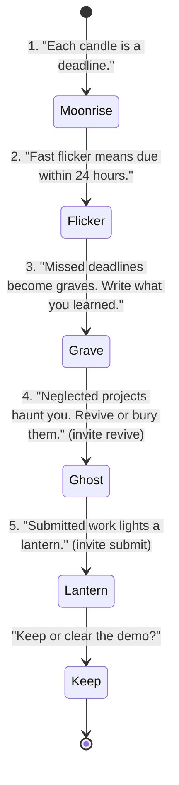

# Design: first-visit

## Overview

A small step machine in `src/ui/intro/` drives captions and camera focus over the real scene with real (demo) items. No pre-rendered video, so what judges see is the app itself.

## Demo seed

```ts
// src/ui/intro/demo-seed.ts (pure, takes now)
export function demoItems(now: EpochMs, zone: string): Item[];
```

| Id | Title | dueAt | lastActivityAt | Shows |
|---|---|---|---|---|
| demo-a | "Demo: Weekend game jam submission" | now + 5 d | now - 8 d | ghost, then candle after revive, then lantern after submit |
| demo-b | "Demo: Course project report" | now + 6 h | now - 1 h | due-soon candle, fast flicker |
| demo-c | "Demo: Scholarship essay" | now - 1 d | now - 2 d | tombstone with sample epitaph "Demo epitaph: start the draft a week earlier." |

All have `demo: true`. Titles are generic and name no real event, person or organisation (R2.3). The "Demo:" prefix is part of the title and the badge is shown as well, so the label survives export and screenshots.

## Steps



Timing in full motion: about 10 s per step, so 50 s plus user choices, under 60 s for a passive viewer (R1.2). In reduced motion every step waits for Next (R1.4).

## Interfaces

```ts
type IntroStep = 'moonrise' | 'flicker' | 'grave' | 'ghost' | 'lantern' | 'keep';
export function nextStep(step: IntroStep): IntroStep | null;
export function shouldStartIntro(itemCount: number, introSeen: boolean): boolean; // R1.1, R2.6
export function clearDemo(items: Item[]): Item[];                                  // R2.5
```

## Error handling

- If storage is not persistent, the intro still runs and the "intro seen" flag is kept in memory for the session.
- If the user deletes a demo item mid-intro, steps that point at it show their caption without the pointer.

## Testing strategy

- Unit: `demoItems` gives exactly 3 items with the statuses in the table at `now` (ghost, due-soon, missed), all `demo: true`, all titles start with "Demo:"; `clearDemo` removes only demo items (property test with mixed lists); `shouldStartIntro`.
- E2E: fresh context runs the intro and finishes in under 60 s passive; Skip and Escape both work; reduced-motion run advances only on Next; `.ics` export contains "[Demo]".
- The video shot list in `VIDEO_SHOTLIST.md` follows these steps.
