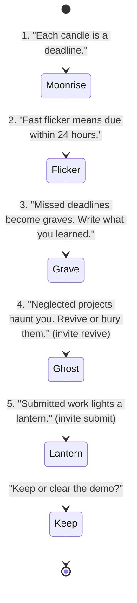

# Design: first-visit

## Overview

A small step machine in `src/ui/intro/` drives captions and camera focus over the real scene with real (demo) items. No pre-rendered video, so what judges see is the app itself.

## Demo seed

```ts
// src/ui/intro/demo-seed.ts (pure, takes now)
export function demoItems(now: EpochMs, zone: string): Item[];
```

| Id | Title | dueAt | lastActivityAt | Shows |
|---|---|---|---|---|
| demo-a | "Demo: Weekend game jam submission" | now + 5 d | now - 8 d | ghost, then candle after revive, then lantern after submit |
| demo-b | "Demo: Course project report" | now + 6 h | now - 1 h | due-soon candle, fast flicker |
| demo-c | "Demo: Scholarship essay" | now - 1 d | now - 2 d | tombstone with sample epitaph "Demo epitaph: start the draft a week earlier." |

All have `demo: true`. Titles are generic and name no real event, person or organisation (R2.3). The "Demo:" prefix is part of the title and the badge is shown as well, so the label survives export and screenshots.

## Steps



Timing in full motion: about 10 s per step, so 50 s plus user choices, under 60 s for a passive viewer (R1.2). In reduced motion every step waits for Next (R1.4).

## Interfaces

```ts
type IntroStep = 'moonrise' | 'flicker' | 'grave' | 'ghost' | 'lantern' | 'keep';
export function nextStep(step: IntroStep): IntroStep | null;
export function shouldStartIntro(itemCount: number, introSeen: boolean): boolean; // R1.1, R2.6
export function clearDemo(items: Item[]): Item[];                                  // R2.5
```

## Error handling

- If storage is not persistent, the intro still runs and the "intro seen" flag is kept in memory for the session.
- If the user deletes a demo item mid-intro, steps that point at it show their caption without the pointer.

## Testing strategy

- Unit: `demoItems` gives exactly 3 items with the statuses in the table at `now` (ghost, due-soon, missed), all `demo: true`, all titles start with "Demo:"; `clearDemo` removes only demo items (property test with mixed lists); `shouldStartIntro`.
- E2E: fresh context runs the intro and finishes in under 60 s passive; Skip and Escape both work; reduced-motion run advances only on Next; `.ics` export contains "[Demo]".
- The video shot list in `VIDEO_SHOTLIST.md` follows these steps.

## Change from the first draft

Written while building tasks 1 to 6 (16 Nov 2026). Where this differs from the sections above, this section is what the code does.

- **Files.** The pure step machine, captions, step times and step targets are in `src/ui/intro/steps.ts`, so they are tested without a DOM; `Intro.tsx` is only the panel. `demo-seed.ts` also exports `withDemo(items, now, zone)` (old demo items out, 3 fresh ones in, so a replay can never double them) and `SETTING_INTRO_SEEN = 'intro-seen'`. Demo ids are fixed (`demo-a`, `demo-b`, `demo-c`) and due times are rounded up to a whole minute.
- **Timing.** Full motion: 9, 8, 10, 11 and 11 s per step, 49 s in all; the passive e2e run measured 49.3 s from the panel opening to the keep question. The step clock is a GSAP timeline, so `pauseWhenHidden` also pauses it in a hidden tab. A **Pause the tour** button (full motion only) holds the step for as long as the user wants, for WCAG 2.2.2. Reduced motion creates no timer and the panel says "Motion is reduced, so each step waits for Next."
- **Panel.** A modal `<dialog>` at the bottom of the screen with a transparent backdrop, labelled "First visit, step N of 5" plus the step title; the caption sits in a polite live region, so auto-advance is read out without moving focus. Next has focus at the start; when an answered or declined invitation disappears, focus goes to Next; the closing question starts on **Keep the demo**. Skip, Escape and the closing choice all set the flag.
- **Camera and pointer.** No zoom. A radial-gradient spotlight in the scene dims everything outside the target slot, a dashed lantern-coloured ring frames the slot, and the page scrolls so the slot sits above the panel (the scene's own sideways scroller follows on narrow screens). Full motion glides there (`gsap.to` with `attr` for the spotlight and ring, a plain-object tween for scrolling, 0.8 to 0.9 s, `power2.out`); reduced motion and the first aim of each intro jump. Step 1 points at B with the spotlight wide open; the closing question shows the whole scene with no ring.
- **Skip keeps the demo.** Skipping does not ask the keep-or-clear question (R2.4 is about the end of the intro, and R1.5 sends focus to the scene). Instead, while demo items exist, a note above the scene says how many there are and has a **Clear demo** button. The permanent menu actions (Clear demo, Replay the intro) are in a "Demo and first visit" section of Export and settings. Replay asks first whenever any item is stored (R2.6) and says whether it adds demo items next to the user's own or only replaces old demo items.
- **Séance invite.** Hidden while the intro runs, so the two never compete. After the intro it shows as usual, because the demo items are real items a judge can hold a séance with.
- **Labels.** The ".ics contains [Demo]" check holds as `SUMMARY:[Demo] Demo: Weekend game jam submission`: the export marker and the title prefix both stay, so a copied title still says Demo.
- **Scene text moved out of the buttons.** The first axe scan with the demo items failed `label-content-name-mismatch` (serious, WCAG 2.5.3) on all 3 scene items: the visible text inside each `role="button"` group (a truncated title, the Demo badge, the engraved epitaph) was not a contiguous part of its accessible name. The same failure was waiting for any long title or any tombstone with an epitaph; the earlier e2e scans used short titles only. Each slot is now a group holding the button (shapes only) and an `aria-hidden`, `pointer-events="none"` text layer on top, so clicks still reach the button and screen readers get the same name as before.
- **E2E as built.** `e2e/first-visit.spec.ts` has 5 tests: the passive full-motion tour (5 titles seen, at most 60 s, keep, focus on the first scene item, Demo badges and the demo epitaph in the list view, 3 `[Demo]` events in the `.ics`, no intro after a reload); Skip intro and Replay the intro (with its confirmation, still 3 items); Escape at step 2; reduced motion (still on step 1 after 12.5 s, revive accepted, lantern declined, Clear demo, focus on Add deadline); and reduced motion with the ghost declined and the lantern lit (the `.ics` then holds the 2 open demo items). The intro is scanned with axe at step 1 in both motion modes, at the ghost step and at the closing question, failing on serious or critical violations; `smoke.spec.ts` scans the first visit with and without the intro and fails on any violation. Every other spec starts from an empty graveyard through `e2e/helpers.ts` (skip, Clear demo, reload), so their counts did not change.

Docs relied on (checked 16 Nov 2026): GSAP v3 [Attributes (AttrPlugin, in core)](https://gsap.com/docs/v3/GSAP/CorePlugins/Attributes), [gsap.timeline()](https://gsap.com/docs/v3/GSAP/gsap.timeline()/) (`onComplete`, `pause()`, `resume()`), [gsap.to()](https://gsap.com/docs/v3/GSAP/gsap.to()/) (plain objects, `onUpdate`, `overwrite`); Playwright [page.emulateMedia](https://playwright.dev/docs/api/class-page#page-emulate-media) (`reducedMotion`) and [Download](https://playwright.dev/docs/api/class-download) (`createReadStream`).
