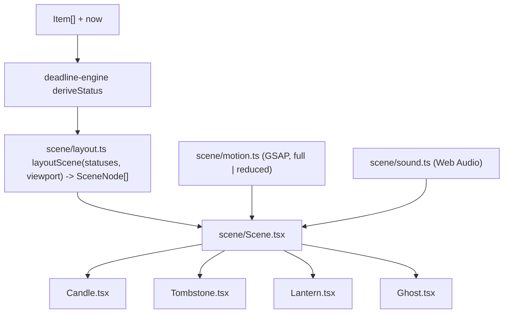

# Design: graveyard-scene

## Overview

`src/scene/` renders a Preact component tree that outputs one `<svg>`. Layout is computed by a pure function from the derived status list, so it is unit-testable without a browser. GSAP drives only presentation attributes on elements that already exist; it never decides state.

## Architecture



## Data model

```ts
type MotionMode = 'full' | 'reduced';
interface SceneNode {
  id: string;
  kind: 'candle' | 'tombstone' | 'lantern' | 'ghost';
  status: Status;
  x: number; y: number;          // in viewBox units (0..1600 x 0..900)
  wax?: number;                  // 0.05..1 for candles
  flicker?: 'slow' | 'fast';
  ghostDistance?: number;        // 0..1, 0 at 7 days, 1 at 30+ days
  label: string;                 // title, used for focus and list view parity
  demo: boolean;
}
```

## Interfaces

```ts
// scene/layout.ts (pure)
export function waxFraction(item: Item, now: EpochMs): number;           // R2.1
export function ghostDistance(item: Item, now: EpochMs): number;         // R2.6
export function layoutScene(items: Item[], now: EpochMs, width: number): SceneNode[];

// scene/motion.ts
export function initialMotion(mq: MediaQueryList, saved: MotionMode | null): MotionMode; // R3.1
export function createTimeline(mode: MotionMode, build: (tl: gsap.core.Timeline) => void): gsap.core.Timeline | null;
export function flickerPeriod(flicker: 'slow' | 'fast'): number;        // 2.4 s or 0.5 s

// scene/sound.ts
export function createSound(): { enable(): Promise<void>; disable(): void; chime(): void; enabled: boolean };
```

GSAP APIs to confirm in gsap.com docs before use: `gsap.timeline`, `gsap.to`, `gsap.quickTo` (parallax), `gsap.matchMedia` (could replace the hand-written reduced-motion check), `globalTimeline.pause/resume` (R5.4). Web Audio APIs to confirm on MDN: `AudioContext`, `OscillatorNode`, `GainNode`, `BiquadFilterNode`, `AudioBufferSourceNode` with generated noise for wind.

## Error handling

- If GSAP fails to load or throws, the scene renders statically (same as reduced mode).
- If `AudioContext` is unavailable, the sound toggle is disabled with a short explanation.
- Fonts fall back to the system serif and sans stacks.

## Testing strategy

- Unit tests for `waxFraction`, `ghostDistance`, `layoutScene` (positions, one node per item, kinds per status, demo flag), `initialMotion`, `flickerPeriod` (fast period gives at most 3 flashes per second).
- happy-dom component tests: each kind renders, decorative layers are `aria-hidden`, demo badge present.
- Playwright: screenshots in both motion modes with `page.emulateMedia({ reducedMotion: 'reduce' })`, checks that no element has a running GSAP tween in reduced mode, and an axe scan.
- design-review agent pass with Playwright MCP before the polish phase ends.
