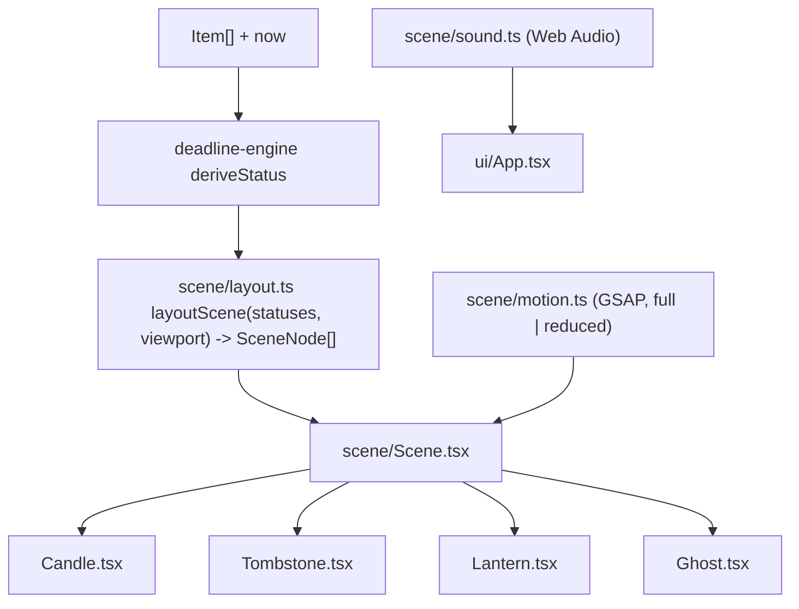

# Design: graveyard-scene

## Overview

`src/scene/` renders a Preact component tree that outputs one `<svg>`. Layout is computed by a pure function from the derived status list, so it is unit-testable without a browser. GSAP drives only presentation attributes on elements that already exist; it never decides state.

## Architecture



## Data model

```ts
type MotionMode = 'full' | 'reduced';
type SceneKind = 'candle' | 'tombstone' | 'lantern' | 'ghost';
interface SceneNode {
  id: string;
  kind: SceneKind;
  status: Status;
  x: number; y: number;          // slot centre x and slot top y, in viewBox units (width 1600)
  w: number; h: number;          // slot size; the element draws only inside its slot
  wax: number;                   // 0.05..1 for candles, 0 otherwise (domain/visual.ts waxFraction)
  flicker: { speed: 'slow' | 'fast'; urgency: number } | null; // domain/visual.ts flicker
  ghostDistance: number;         // 0..1, 0 at 7 days, 1 at 30+ days (domain/visual.ts)
  title: string;
  epitaph?: string;
  demo: boolean;
}
interface SceneLayout { width: number; height: number; fenceY: number; groundY: number; nodes: SceneNode[] }
```

Layout bands, top to bottom: ghosts, lanterns on the fence, ground (candles and tombstones). Each band places its items in due order, centred, and wraps into extra rows when full; the scene height grows instead of items overlapping (fast-check property in `layout.property.test.ts`). The accessible name of each item comes from the accessible-list-view view model, not from the layout.

## Interfaces

```ts
// scene/layout.ts (pure). waxFraction, flicker and ghostDistance live in domain/visual.ts
// (deadline-engine design) so the list view can read the same numbers; layout imports them.
export function layoutScene(items: readonly Item[], now: EpochMs, width?: number): SceneLayout;

// scene/motion.ts
export function initialMotion(mq: { matches: boolean } | null, saved: MotionMode | null): MotionMode; // R3.1, R3.2
export function flickerPeriod(speed: 'slow' | 'fast'): number;   // 2.4 s or 0.5 s (2 flashes per second)
export function motionPlan(mode: MotionMode): MotionPlan;          // every loop false in 'reduced'
export function parallaxOffset(px: number, py: number, scroll: number, maxPx: number): { x: number; y: number };
export function startAmbient(mode: MotionMode, root: SVGSVGElement, viewWidth: number): (() => void) | null; // null in 'reduced'
export function animateStatusChange(mode: MotionMode, el: SVGElement): void; // R2.8
export function pauseWhenHidden(doc: Document): () => void;               // R5.4

// scene/sound.ts
export function createSound(factory?: () => AudioContext): { enable(): Promise<void>; disable(): void; chime(): void; readonly enabled: boolean };
```

GSAP APIs used, confirmed in the gsap.com v3 docs on 15 Nov 2026: `gsap.context` (collects every tween so `revert()` kills them all), `gsap.to`, `gsap.fromTo`, `gsap.quickTo` (parallax), `gsap.globalTimeline.pause/resume` (R5.4). `gsap.matchMedia` is a wrapper around `gsap.context`; it is not used because the manual toggle must win over the media query (R3.2), so App resolves the mode from `window.matchMedia` plus the saved setting and passes it in. In `reduced` mode `startAmbient` returns before creating anything, so no tween exists that could run continuously. Animated elements (`data-flame`, `data-fog`, `data-ghost-body`, `data-depth` layers) never carry their own `transform` attribute, so GSAP does not fight the layout.

Web Audio APIs used, confirmed on MDN: `AudioContext` (created inside the sound switch click handler, per the MDN autoplay guidance), `createBuffer` + `AudioBufferSourceNode` with `loop` (generated wind noise), `BiquadFilterNode` (low-pass), `OscillatorNode` (gust LFO and chime), `GainNode`, `AudioParam.setValueAtTime / linearRampToValueAtTime / setTargetAtTime` (fade out with time constant 30 ms, 95% after 90 ms), `AudioContext.close()` after 150 ms (R4.5).

Narrow screens (R1.5): the SVG keeps a minimum width of 960 px inside a horizontally scrolling container, with a visible "Scroll sideways" hint below 960 px and the full list view underneath.

## Error handling

- If GSAP fails to load or throws, the scene renders statically (same as reduced mode).
- If `AudioContext` is unavailable, the sound toggle is disabled with a short explanation.
- Fonts fall back to the system serif and sans stacks.

## Testing strategy

- Unit tests for `waxFraction`, `ghostDistance`, `layoutScene` (positions, one node per item, kinds per status, demo flag), `initialMotion`, `flickerPeriod` (fast period gives at most 3 flashes per second).
- happy-dom component tests: each kind renders, decorative layers are `aria-hidden`, demo badge present.
- Playwright (`e2e/a11y.spec.ts`): with `page.emulateMedia({ reducedMotion: 'reduce' })` the flame `transform` attribute does not change over 350 ms, while in full motion it does; screenshots; axe scans. The page cannot reach the bundled GSAP instance, so the "no running tween" check is a happy-dom unit test (`motion.test.ts`, `Scene.test.tsx`) on `gsap.globalTimeline`.
- design-review agent pass with Playwright MCP before the polish phase ends.
