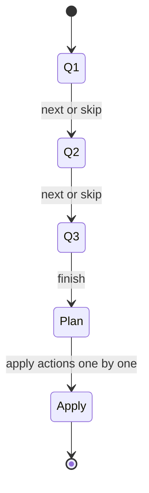

# Design: seance

## Overview

`src/seance/` holds a pure plan builder and the question flow component. The builder is deterministic given items, answers and `now`, so it is unit- and property-tested. The optional LLM only receives the finished plan text and returns a rephrasing that is accepted only if it keeps every item title.

## Data model

```ts
interface SeanceAnswers {
  restless: { itemIds: string[]; note: string };  // Q1
  lessons: { itemIds: string[]; note: string };   // Q2
  keepAlive: { itemIds: string[]; note: string }; // Q3
}
interface PlanStep { itemId: string; title: string; dueAt: EpochMs; action: 'work' | 'revive' | 'bury' | 'epitaph'; reason: string }
interface Plan { weekStart: EpochMs; steps: PlanStep[]; lessons: string[]; text: string }
interface SeanceRecord { id: string; at: EpochMs; answers: SeanceAnswers; plan: Plan }
```

As built in `src/seance/plan.ts` (first draft above):

```ts
type Answer = { itemIds: string[]; note: string };
type SeanceAnswers = { restless: Answer; lessons: Answer; keepAlive: Answer }; // Q1, Q2, Q3
type PlanSection = 'keep' | 'due' | 'let-go' | 'lessons';
type PlanStep = { itemId: string; title: string; dueAt: EpochMs; demo: boolean; section: PlanSection; action: 'work' | 'revive' | 'bury' | 'epitaph'; reason: string; epitaph?: string };
type Plan = { weekStart: EpochMs; steps: PlanStep[]; lessons: string[]; promise: string; dropped: number; text: string };
type SeanceRecord = { id: string; at: EpochMs; answers: SeanceAnswers; plan: Plan };
```

- Change from the first draft: type aliases instead of interfaces, so a record is assignable to the storage `JsonValue` type and can be saved with `putSetting`.
- Change from the first draft: `PlanStep.demo` keeps the Demo label on every place the Séance shows an item (pick list, plan steps, confirmations, button names, plan text and history); `section` fixes the order keep, due, let-go, lessons; `epitaph` holds the lesson offered for engraving. `Plan.promise` is the Q3 note and `Plan.dropped` counts picked ids that no longer exist (the "Error handling" note below).
- Change from the first draft: `buildPlan(items, answers, now, display?)` takes an optional `{ locale, zone }` so the plan text shows times in the user's zone. The steps do not depend on it.

## Interfaces

```ts
export function candidatesFor(question: 1 | 2 | 3, items: Item[], now: EpochMs): Item[]; // R1.1
export function buildPlan(items: Item[], answers: SeanceAnswers, now: EpochMs): Plan;     // R1.3, R2.1 to R2.4
export function renderPlanText(plan: Plan, locale: string, zone: string): string;          // templates
export function isSeanceDue(lastAt: EpochMs | null, now: EpochMs): boolean;                // R1.4, 7 x 24 h
export async function phrase(plan: Plan, provider: LlmProvider): Promise<{ text: string; source: 'rules' | 'llm' }>; // R2.5
```

`phrase` accepts LLM text only if every step title appears in it and its length is under 2,000 characters; otherwise it returns the rule-based text with `source: 'rules'`.

- Change from the first draft: the titles must appear in plan order, and the reply must still say "Demo" when the plan has demo items. The provider receives only the rule-based plan text, never the answers. Its reply is shown as a separate block of text; the steps and their buttons always come from the rule-based plan, so an LLM cannot change the items, order or actions (R2.5). With provider `none` there is no rephrase button and `phrase` returns before any call (R2.4).
- Lessons (R2.3): one lesson per non-empty line of the Q2 note, at most 10. Each Q2 pick that is missed or buried and has no epitaph is offered the next lesson, cut to the 280-character epitaph limit; when there are more graves than lessons the last lesson is offered again.
- History (R3.1, R3.2): every record lives in one settings value, `seance-history`, newest first and capped at 52 (about a year of weeks). Settings are part of JSON backups already; the history nests 6 levels deep, under the backup limit of 10. `parseHistory` checks each record read back (a restored backup is untrusted) and drops a bad one instead of the whole list.
- Invitation (R1.4): a banner above the scene, outside any dialog, shown when `isSeanceDue` is true and there is at least one item. "Not now" hides it until the page reloads. When a finished séance removes the banner, closing the dialog returns focus to the header's "Hold a séance" button.
- Candle circle: three candles, one lit per question reached, aria-hidden because "Question n of 3" says the same in words. The only motion is a 200 ms opacity fade on a flame, turned off in reduced mode (OS setting or the app's toggle).

## Flow



## Error handling

- Items deleted during a séance are dropped from the plan silently with a note.
- LLM failure falls back to rules text with a visible "written by the rules" label.

## Testing strategy

- Unit: `candidatesFor` per question, `buildPlan` ordering, ghost revive or bury suggestion, lessons section, `isSeanceDue` boundary.
- Property: for any items and answers, `buildPlan` contains each Q3 item before any non-Q3 item, contains only unresolved items in steps, and is deterministic for the same inputs.
- `phrase` with a fake provider that drops a title falls back to rules.
- E2E: complete a séance with keyboard only; axe scan of each step.
  - As built in `e2e/seance.spec.ts`: deadlines are added through the form (one missed, one due soon, one active). The keyboard test reaches every control with Tab, checks picks with Space, skips Q2, goes Back, finishes, checks the section and step order, opens the epitaph confirmation, cancels it with Not now, then confirms it, and closes with Escape. The axe test scans the dialog at Q1, Q2, Q3, the plan and the open confirmation, and fails on serious or critical violations; it runs with `reducedMotion: 'no-preference'` and `'reduce'` and checks the flame transition is 0.2 s and 0 s.
