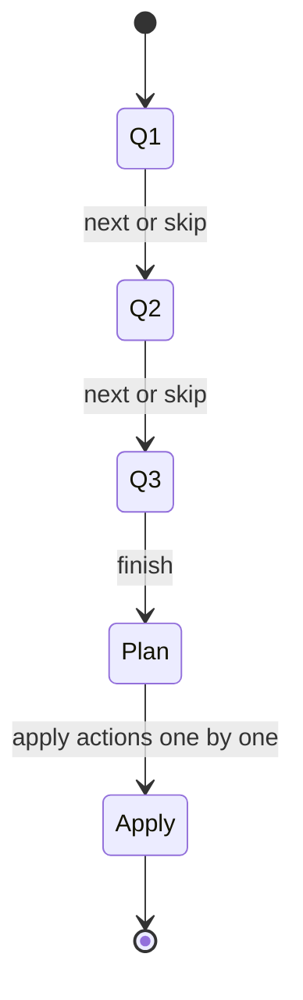

# Design: seance

## Overview

`src/seance/` holds a pure plan builder and the question flow component. The builder is deterministic given items, answers and `now`, so it is unit- and property-tested. The optional LLM only receives the finished plan text and returns a rephrasing that is accepted only if it keeps every item title.

## Data model

```ts
interface SeanceAnswers {
  restless: { itemIds: string[]; note: string };  // Q1
  lessons: { itemIds: string[]; note: string };   // Q2
  keepAlive: { itemIds: string[]; note: string }; // Q3
}
interface PlanStep { itemId: string; title: string; dueAt: EpochMs; action: 'work' | 'revive' | 'bury' | 'epitaph'; reason: string }
interface Plan { weekStart: EpochMs; steps: PlanStep[]; lessons: string[]; text: string }
interface SeanceRecord { id: string; at: EpochMs; answers: SeanceAnswers; plan: Plan }
```

## Interfaces

```ts
export function candidatesFor(question: 1 | 2 | 3, items: Item[], now: EpochMs): Item[]; // R1.1
export function buildPlan(items: Item[], answers: SeanceAnswers, now: EpochMs): Plan;     // R1.3, R2.1 to R2.4
export function renderPlanText(plan: Plan, locale: string, zone: string): string;          // templates
export function isSeanceDue(lastAt: EpochMs | null, now: EpochMs): boolean;                // R1.4, 7 x 24 h
export async function phrase(plan: Plan, provider: LlmProvider): Promise<{ text: string; source: 'rules' | 'llm' }>; // R2.5
```

`phrase` accepts LLM text only if every step title appears in it and its length is under 2,000 characters; otherwise it returns the rule-based text with `source: 'rules'`.

## Flow



## Error handling

- Items deleted during a séance are dropped from the plan silently with a note.
- LLM failure falls back to rules text with a visible "written by the rules" label.

## Testing strategy

- Unit: `candidatesFor` per question, `buildPlan` ordering, ghost revive or bury suggestion, lessons section, `isSeanceDue` boundary.
- Property: for any items and answers, `buildPlan` contains each Q3 item before any non-Q3 item, contains only unresolved items in steps, and is deterministic for the same inputs.
- `phrase` with a fake provider that drops a title falls back to rules.
- E2E: complete a séance with keyboard only; axe scan of each step.
